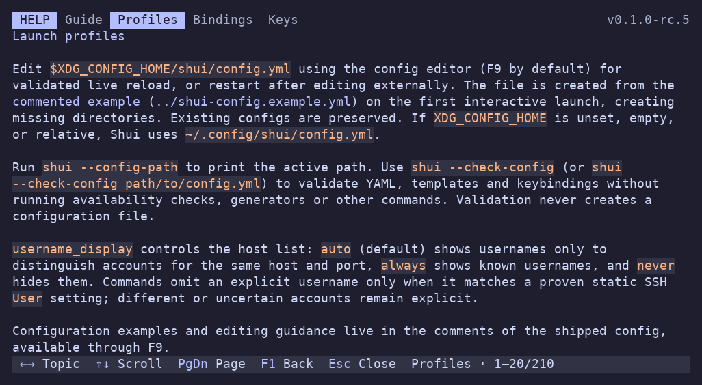

# Shui (Shell UI)

**Your remotes, one terminal menu.**

Find a machine, choose how to connect, and press Enter. Shui brings your SSH hosts, recent connections, remote file browser, and session launcher into one searchable list. Each host can use its own launch profile, and new machines can run a setup recipe before the first connection.


**Type to fuzzy-search · ↑↓ to select · ←→ to choose a profile · Enter to connect**

[Install](#installation) · [User guide](docs/usage.md) · [Configuration](docs/configuration.md) · [Setup recipes](docs/setup.md)

## What you can do

| Choose | Shortcut | Open |
| --- | --- | --- |
| **SSH** | Alt+S | Your usual remote shell, using existing SSH settings |
| **Mosh** | Alt+M | A Mosh session for connections that need to survive network changes |
| **MC** | Alt+C | Midnight Commander browsing the remote filesystem |
| **Bash** | Alt+B | An interactive remote Bash login shell |
| **Zellij** | Alt+Z | An existing remote session, or a new session if none exists |
| **Tmux** | Alt+T | Attach to the remote `main` session, creating it if needed |
| **SFTP** | Alt+F | An interactive file-transfer session |
| **Monitor** | Alt+H | Compact health dashboard: CPU, memory, disks, network and supported GPUs |
| **Tunnel / SOCKS** | Ctrl+Alt+L / Ctrl+Alt+D | A localhost port forward or SOCKS proxy, with editable settings |
| **Your own profile** | Configurable | Any command or remote script defined in YAML |

Hosts come from SSH config, Bash history, and Midnight Commander bookmarks. Launch choices are remembered through history, so you can return to the same machine with the same tool. Press **F4** to configure the selected host or **Shift+F4** to add a new remote, choose an SSH keypair (or generate one when none exists), and optionally install dotfiles. Setup can also copy your terminal definition. Launch profiles offer to install their missing tools when you use them.

Written in Rust with [Ratatui](https://ratatui.rs/), Shui uses a compact, borderless [Catppuccin Mocha](https://catppuccin.com/palette/) interface. Linux builds are static executables. SSH, Mosh, and other connection tools run as separate programs, with your terminal restored before handoff.

## Get started

Run `shui`, type to fuzzy-search your hosts and their SSH config settings/comments, and press Enter to connect, or use a profile shortcut to connect immediately. Start with a filter using `shui prod`. The single-row action bar reveals shortcuts for the exact Alt, Shift, Ctrl, or combined modifiers held. **Alt+Enter** connects and returns to the menu afterward. **Ctrl+Enter** adjusts one connection. **F4** configures the selected host. **Shift+F4** adds a new remote. **F9** edits and validates configuration. **F1** opens the built-in documentation, including navigation help and the configuration reference.

## Installation

Install **[v0.1.0-rc.8](https://github.com/azazar/shui/releases/tag/v0.1.0-rc.8)** with a verified download. Release publication requires all platform builds and checks to pass. Use an explicit version for release candidates; GitHub's `latest` download URL excludes prereleases.

F1 help is embedded in the executable and works offline. You only need to install `shui` (or `shui.exe`); the documentation files in the archive are optional.

[Linux and macOS](#linux-and-macos) · [Windows](#windows) · [Manual downloads](#get-a-binary) · [Build from source](#build-from-source)

### Linux and macOS

```sh
curl -fsSL https://azazar.github.io/shui/scripts/install.sh | sh
```

Detects your platform, verifies the download, and installs to `~/.local/bin` without sudo.

Add `~/.local/bin` to your `PATH` (in Bash or Zsh: `export PATH="$HOME/.local/bin:$PATH"`). Add that line to your shell's startup file to keep it across sessions. Linux builds have no dynamic libc dependency. macOS builds use system libraries and are not signed or notarized.

### Windows

```powershell
irm https://azazar.github.io/shui/scripts/install.ps1 | iex
```

Selects x64 or ARM64, verifies the download, and installs to `~/.local/bin`. Add that directory to your `PATH` if needed. Set `SHUI_INSTALL_DIR` to choose a different install directory on either platform.

For a manual download, compare `Get-FileHash -Algorithm SHA256 .\shui-x86_64-pc-windows-msvc.zip` with the matching entry in `SHA256SUMS` before extracting the executable.

Use **[Git for Windows](https://git-scm.com/downloads/win)** for the POSIX `sh` used by command templates. From PowerShell or Windows Terminal, add Git’s `bin` and `usr/bin` directories to `PATH`; Git Bash already provides it. Shui reads the native `USERPROFILE` and `USERNAME`, ignores a conflicting POSIX `HOME`, and defaults to Notepad for config editing. `VISUAL` / `EDITOR` use Windows command-line quoting (quote executable paths containing spaces). Configuration remains under `XDG_CONFIG_HOME/shui.yml`, falling back to `%USERPROFILE%/.config/shui.yml`; discovery reads `%USERPROFILE%/.ssh/config`. Read-only CLI commands do not require a shell. For WSL, install a Linux build inside WSL instead.

### Get a binary

Choose your platform archive and download [SHA256SUMS](https://github.com/azazar/shui/releases/download/v0.1.0-rc.8/SHA256SUMS) from the same release.

For development builds, use the **Artifacts** section of a successful [Binaries workflow](https://github.com/azazar/shui/actions/workflows/binaries.yml) run. Downloading Actions artifacts requires signing in to GitHub. Each artifact ZIP contains a platform archive and its `.sha256` checksum file—extract that outer ZIP first.

| System | Archive to choose |
| --- | --- |
| Linux x86-64 | [shui-x86_64-unknown-linux-musl.tar.gz](https://github.com/azazar/shui/releases/download/v0.1.0-rc.8/shui-x86_64-unknown-linux-musl.tar.gz) |
| Linux ARM64 | [shui-aarch64-unknown-linux-musl.tar.gz](https://github.com/azazar/shui/releases/download/v0.1.0-rc.8/shui-aarch64-unknown-linux-musl.tar.gz) |
| Linux ARMv7, hard-float | [shui-armv7-unknown-linux-musleabihf.tar.gz](https://github.com/azazar/shui/releases/download/v0.1.0-rc.8/shui-armv7-unknown-linux-musleabihf.tar.gz) |
| macOS Intel | [shui-x86_64-apple-darwin.tar.gz](https://github.com/azazar/shui/releases/download/v0.1.0-rc.8/shui-x86_64-apple-darwin.tar.gz) |
| macOS Apple Silicon | [shui-aarch64-apple-darwin.tar.gz](https://github.com/azazar/shui/releases/download/v0.1.0-rc.8/shui-aarch64-apple-darwin.tar.gz) |
| Windows x64 | [shui-x86_64-pc-windows-msvc.zip](https://github.com/azazar/shui/releases/download/v0.1.0-rc.8/shui-x86_64-pc-windows-msvc.zip) |
| Windows ARM64 | [shui-aarch64-pc-windows-msvc.zip](https://github.com/azazar/shui/releases/download/v0.1.0-rc.8/shui-aarch64-pc-windows-msvc.zip) |

#### Verify and install on Linux or macOS

After downloading your archive and the release's [SHA256SUMS](https://github.com/azazar/shui/releases/download/v0.1.0-rc.8/SHA256SUMS), select exactly one matching checksum:

```sh
archive=shui-x86_64-unknown-linux-musl.tar.gz  # Change for your platform.
awk -v name="$archive" '$2 == name { print; count++ } END { if (count != 1) exit 1 }' SHA256SUMS > "$archive.sha256"
```

Actions artifacts already include the archive's `.sha256` file. Verify the checksum before extracting or installing anything:

```sh
sha256sum -c "$archive.sha256"  # macOS: shasum -a 256 -c "$archive.sha256"
```

Continue only if verification reports **OK**. The checksums detect incomplete or altered downloads; they are distributed by the same release publisher as the archives. Extract the executable and install it:

```sh
tar -xzf "$archive" shui &&
mkdir -p "$HOME/.local/bin" &&
install -m 755 shui "$HOME/.local/bin/shui"
export PATH="$HOME/.local/bin:$PATH"
shui
```

### Build from source

Install [Rust via rustup](https://rustup.rs/), then:

```sh
git clone https://github.com/azazar/shui.git
cd shui
cargo build --locked --release
./target/release/shui
```

The repository pins its Rust toolchain. To build the RC source specifically, run `git checkout v0.1.0-rc.8` before building. On Linux x86-64, add `--target x86_64-unknown-linux-musl` for a static build; the binary will be in `target/x86_64-unknown-linux-musl/release/`.

### Requirements

Use a UTF-8 terminal with a monospace font. The action bar needs no Powerline or Nerd Font glyphs. Install the tools for the profiles you use: `ssh` for normal connections, `mosh` locally and `mosh-server` remotely for Mosh, or local `mc` for file browsing. SFTP uses local `sftp`; Tmux needs remote `tmux`; Monitor needs remote `btop` (GPU support depends on its build and the remote drivers). The terminal-definition recipe needs local `infocmp` and remote `tic`. Key-auth setup uses `ssh-copy-id` and offers `ssh-keygen` when no keypair exists; the dotfiles sample also uses `scp`.

### Command-line options

Run `shui` to open the menu, or `shui prod` to start with a search filter. Use `shui --dump` to list hosts without opening the UI. `shui --config-path` prints the configuration location, and `shui --check-config` validates the current configuration without running commands. Use `shui --check-config ./config.yml` for a draft file. `--help` and `--version` are also available.

### Upgrading

Re-run the install command for your platform to replace the executable. Check `shui --version` afterward; this release is **0.1.0-rc.8**. Help remains embedded, so no separate documentation installation is needed.

If upgrading from an older configuration path, move your existing configuration to `$XDG_CONFIG_HOME/shui.yml` (default: `~/.config/shui.yml`) before the first launch to preserve custom settings. Older paths are not loaded or migrated automatically. When upgrading from the previous project name, update shell aliases and scripts to invoke `shui`.

An existing `$XDG_CONFIG_HOME/shui.yml` is never overwritten. To adopt new profiles or recipes, merge complete entries from the [commented config](docs/config.example.yml), including their inputs and script fields. Preserve your custom commands and choose unused shortcuts. Saving through F9 validates and reloads the result; restart after external edits.

## Documentation

The [documentation index](docs/README.md) covers daily use, installation, configuration, setup scripts, and development. The user guide, profiles, and setup recipes are embedded in the executable and available offline through **F1**: Guide and Profiles from the host list, or Setup from the remote setup dialog.



Edit `$XDG_CONFIG_HOME/shui.yml` (default: `~/.config/shui.yml`) to customize launch profiles, setup recipes and all app keybindings. Default profiles offer installation of missing dependencies before continuing; profile shortcuts launch the selected host directly. The [commented example](docs/config.example.yml) contains the shipped defaults, editing guidance and configuration examples. Existing configs are preserved; see [upgrading](#upgrading) when merging new defaults.

Use `shui --config-path` to find your configuration and `shui --check-config` to validate it without launching commands or opening the UI. Pass a filename to validate a draft: `shui --check-config ./config.yml`.

## License

[GPL-3.0-only](LICENSE).
