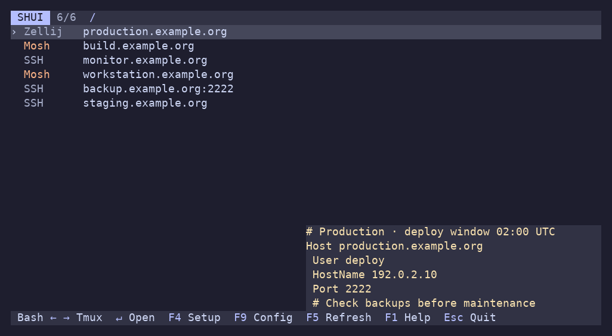

# Shui (Shell UI)

**Your remotes, one terminal menu.**

Find a machine, choose how to connect, and press Enter. Shui brings your SSH hosts, recent connections, remote file browser, and session launcher into one searchable list. Each host can use its own launch profile, and new machines can run a setup recipe before the first connection.



**Type to fuzzy-search · ↑↓ to select · ←→ to choose a profile · Enter to connect**

[Install](#installation) · [User guide](docs/usage.md) · [Configuration](docs/configuration.md) · [Setup recipes](docs/setup.md)

## What you can do

| Choose | Shortcut | Open |
| --- | --- | --- |
| **SSH** | Alt+S | Your usual remote shell, using existing SSH settings |
| **Dropbear** | Alt+D | A lightweight SSH session using `dbclient` |
| **PuTTY** | Alt+P | A PuTTY SSH window on Windows |
| **Plink** | Alt+L | A PuTTY SSH connection in the current Windows terminal |
| **Mosh** | Alt+M | A Mosh session for connections that need to survive network changes |
| **MC** | Alt+C | Midnight Commander browsing the remote filesystem |
| **Bash** | Alt+B | An interactive remote Bash login shell |
| **Zellij** | Alt+Z | An existing remote session, or a new session if none exists |
| **Tmux** | Alt+T | Attach to the remote `main` session, creating it if needed |
| **SFTP** | Alt+F | An interactive file-transfer session |
| **Monitor** | Alt+H | Compact health dashboard: CPU, memory, disks, network and supported GPUs |
| **Tunnel / SOCKS** | Ctrl+Alt+L / Ctrl+Alt+D | A localhost port forward or SOCKS proxy, with editable settings |
| **Your own profile** | Configurable | Any command or remote script defined in YAML |

Hosts come from SSH config, Bash history, and Midnight Commander bookmarks. Shui remembers each host's launch profile. Setup recipes can install tools, configure SSH keys, copy terminal definitions, and deploy dotfiles. Profiles appear when their local clients are installed; remote tools can be installed when you need them.

## Installation

**Linux and macOS** (including WSL):

```sh
curl -fsSL https://azazar.github.io/shui/scripts/install.sh | sh
```

**Windows** (PowerShell):

```powershell
irm https://azazar.github.io/shui/scripts/install.ps1 | iex
```

Both installers detect your platform, verify the download, and install to `~/.local/bin`. Add that directory to your `PATH` if needed. Set `SHUI_INSTALL_DIR` to use another directory. Re-run the command to update.

Windows needs [Git for Windows](https://git-scm.com/downloads/win); use Git Bash or add Git's `bin` and `usr/bin` directories to `PATH`. macOS binaries are unsigned.

[Manual downloads: v0.1.0-rc.8](https://github.com/azazar/shui/releases/tag/v0.1.0-rc.8) · [Build from source](docs/development.md#build-from-source)

## Get started

Run `shui`, or `shui prod` to start with a search filter. Type to search, use **↑↓** to select a host and **←→** to choose a profile, then press **Enter**.

- **Alt+Enter** connects and returns to the menu afterward.
- **Ctrl+Enter** adjusts a single connection.
- **F4** configures a remote; **Shift+F4** adds one.
- **F9** edits configuration; **F1** opens offline help.

Hold **Alt**, **Shift**, or **Ctrl** to reveal the relevant shortcuts.

## Customize

Edit `$XDG_CONFIG_HOME/shui.yml` (default `~/.config/shui.yml`) to change profiles, setup recipes, and keybindings. See [defaults and optional examples](docs/configuration.md#default-config-parts). Validate changes with `shui --check-config`.

[User guide](docs/usage.md) · [Configuration](docs/configuration.md) · [Keybindings](docs/keybindings.md) · [Setup recipes](docs/setup.md) · [Development](docs/development.md)

## License

[GPL-3.0-only](LICENSE).
