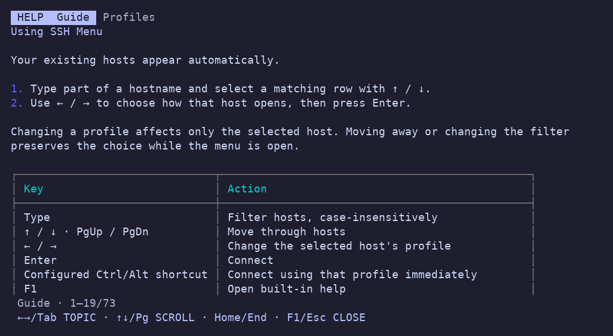

# SSH Menu

**Your remotes, one terminal menu.**

Find a machine, choose how to connect, and press Enter. SSH Menu brings your SSH hosts, recent connections, remote file browser, and session launcher into one searchable list. Each host can use its own launch profile, and new machines can run a setup recipe before the first connection.


**Type to filter · ↑↓ to select · ←→ to choose a profile · Enter to connect**

[Install](docs/installation.md) · [User guide](docs/usage.md) · [Configuration](docs/configuration.md) · [Setup recipes](docs/setup.md)

## What you can do

| Choose | Open |
| --- | --- |
| **SSH** | Your usual remote shell, using existing SSH settings |
| **Mosh** | A Mosh session for connections that need to survive network changes |
| **MC** | Midnight Commander browsing the remote filesystem |
| **Bash** | An interactive remote Bash login shell |
| **Zellij** | An existing remote session, or a new session if none exists |
| **Your own profile** | Any command or remote script defined in YAML |

Hosts come from SSH config, Bash history, and Midnight Commander bookmarks. Launch choices are remembered through history, so you can return to the same machine with the same tool. Press **F2** to add a remote, choose an SSH keypair, and optionally install dotfiles.

Written in Rust with [Ratatui](https://ratatui.rs/), SSH Menu uses a compact, borderless [Catppuccin Mocha](https://catppuccin.com/palette/) interface. Linux builds are static executables. SSH, Mosh, and other connection tools run as separate programs, with your terminal restored before handoff.

## Get started

Install the published **v0.1.0-rc.3** release with the command for your system. Linux and macOS install the executable into `~/.local/bin` without sudo.

**Linux x86-64 (including WSL)**

```sh
mkdir -p "$HOME/.local/bin" && curl -fL https://github.com/azazar/ssh-menu/releases/download/v0.1.0-rc.3/ssh-menu-x86_64-unknown-linux-musl.tar.gz | tar -xz -C "$HOME/.local/bin" ssh-menu
```

**Linux ARM64**

```sh
mkdir -p "$HOME/.local/bin" && curl -fL https://github.com/azazar/ssh-menu/releases/download/v0.1.0-rc.3/ssh-menu-aarch64-unknown-linux-musl.tar.gz | tar -xz -C "$HOME/.local/bin" ssh-menu
```

**Linux ARMv7 (hard-float)**

```sh
mkdir -p "$HOME/.local/bin" && curl -fL https://github.com/azazar/ssh-menu/releases/download/v0.1.0-rc.3/ssh-menu-armv7-unknown-linux-musleabihf.tar.gz | tar -xz -C "$HOME/.local/bin" ssh-menu
```

**macOS Apple Silicon**

```sh
mkdir -p "$HOME/.local/bin" && curl -fL https://github.com/azazar/ssh-menu/releases/download/v0.1.0-rc.3/ssh-menu-aarch64-apple-darwin.tar.gz | tar -xz -C "$HOME/.local/bin" ssh-menu
```

**macOS Intel**

```sh
mkdir -p "$HOME/.local/bin" && curl -fL https://github.com/azazar/ssh-menu/releases/download/v0.1.0-rc.3/ssh-menu-x86_64-apple-darwin.tar.gz | tar -xz -C "$HOME/.local/bin" ssh-menu
```

**Windows x64 — PowerShell**

```powershell
& { $ErrorActionPreference = "Stop"; Invoke-WebRequest https://github.com/azazar/ssh-menu/releases/download/v0.1.0-rc.3/ssh-menu-x86_64-pc-windows-msvc.zip -OutFile "$env:TEMP/ssh-menu.zip"; New-Item -ItemType Directory -Force "$HOME/.local/bin" | Out-Null; tar.exe -xf "$env:TEMP/ssh-menu.zip" -C "$HOME/.local/bin" ssh-menu.exe }
```

**Windows ARM64 — PowerShell**

```powershell
& { $ErrorActionPreference = "Stop"; Invoke-WebRequest https://github.com/azazar/ssh-menu/releases/download/v0.1.0-rc.3/ssh-menu-aarch64-pc-windows-msvc.zip -OutFile "$env:TEMP/ssh-menu.zip"; New-Item -ItemType Directory -Force "$HOME/.local/bin" | Out-Null; tar.exe -xf "$env:TEMP/ssh-menu.zip" -C "$HOME/.local/bin" ssh-menu.exe }
```

Add `~/.local/bin` to your `PATH` (in Bash or Zsh: `export PATH="$HOME/.local/bin:$PATH"`). On Windows, run SSH Menu from [Git Bash](https://git-scm.com/downloads/win); PowerShell is only used for installation. macOS binaries are unsigned. See the [installation guide](docs/installation.md) for checksum verification, platform requirements, and source builds, or browse [GitHub Releases](https://github.com/azazar/ssh-menu/releases).

Help is embedded in the executable. Only `ssh-menu` (or `ssh-menu.exe`) is needed; no documentation files are required for F1 help.

Run `ssh-menu`, type to filter your hosts, and press Enter to connect. **F2** adds a remote with optional setup. **F1** opens the built-in documentation, including navigation help and configuration examples.

## Documentation

The [documentation index](docs/README.md) covers daily use, installation, configuration, setup scripts, and development. The user guide, profiles, and setup recipes are embedded in the executable and available offline through **F1**: Guide and Profiles from the host list, or Setup from the new-remote dialog.



Edit `~/.ssh/ssh-menu-config.yml` to customize launch profiles and setup recipes. Profile `available_command` checks hide unavailable tools at startup. The [commented example](ssh-menu-config.example.yml) contains the shipped defaults.

## License

[GPL-3.0-only](LICENSE).
