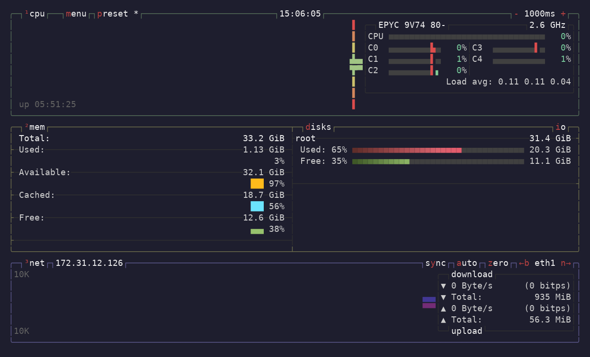
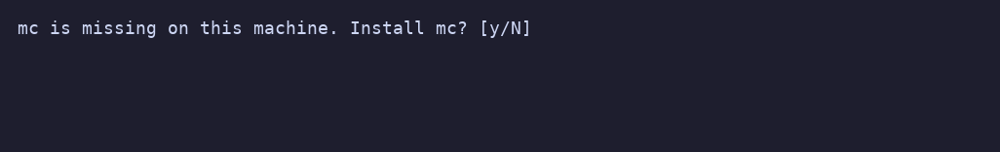

# Launch profiles

Edit **`$XDG_CONFIG_HOME/shui/config.yml`** using the config editor (F9 by default) for validated live reload, or restart after editing externally. The file is created from the [commented example](../shui-config.example.yml) on the first interactive launch, creating missing directories. Existing configs are preserved. If `XDG_CONFIG_HOME` is unset, empty, or relative, Shui uses `~/.config/shui/config.yml`.

Configuration examples and editing guidance live in the comments of the shipped config, available through F9.

Each profile needs a unique `name` and a `command`; `default` names one of them. Commands run through local `sh -c`, and additional string fields can hold reusable commands or scripts. **Placeholders are shell-escaped automatically—leave them unquoted.**

## Included profiles

Alongside SSH, Mosh, MC, Bash and Zellij, the defaults include:

| Profile | Behavior and requirements |
| --- | --- |
| Tmux | Attaches to the remote `main` session or creates it. Requires remote tmux; edit `remote` to use another session name. Detach with tmux's Ctrl+B, then D. |
| SFTP | Interactive OpenSSH file transfers; type `help` for commands and `bye` to exit. Requires local sftp and a remote SFTP subsystem. |
| Monitor | Opens a compact btop health dashboard: CPU/load/temperature, memory/swap, mounted filesystem space, disk busy time, network traffic and supported GPU statistics. Requires remote btop. |
| Tunnel | Opens a dialog for `local port:destination host:port`, default `8080:localhost:80`. The destination is resolved/reached from the SSH server. |
| SOCKS | Opens a dialog for the local proxy port, default `1080`. Configure your client to use SOCKS5 at `127.0.0.1:1080`, with proxy-side DNS when desired. |

Monitor starts with CPU, memory/disks and network panels; the process list is hidden to leave room for health data. Press **4** in btop to toggle processes, **i** to switch disk space/busy meters to read/write graphs, and **n/b** to cycle network interfaces. GPU utilization appears in the CPU panel when btop can detect it; GPU panels can be toggled with **5–0** on supported builds. Temperatures and other sensor data also depend on remote hardware, drivers and permissions. GPU monitoring requires a GPU-enabled btop build and the appropriate driver libraries; installing btop alone cannot guarantee it.

The profile's `dashboard` field holds editable btop settings. Mounted filesystems are read live, including container roots and network mounts. The `disks_filter` excludes common virtual system mounts such as `/proc` and `/dev`; edit it to select or hide particular mounts. The number of visible mounts depends on terminal size. A private temporary config keeps your regular btop layout unchanged and is removed when the monitor exits. When btop is missing, Monitor offers to install it on the remote before opening the dashboard.

Both forwarding profiles bind only to `127.0.0.1`, remain in the foreground, and stop with Ctrl+C. They request no remote shell, fail if the listening socket cannot be created, and use SSH keepalives to detect a lost connection. A successful listener does not guarantee the destination service is reachable; the SSH server must allow forwarding. Use Alt+Enter in the dialog to return to the menu when the tunnel stops. Explicit SSH ports and alias settings work as in the other profiles.

Existing configs are not migrated. Copy the desired entries from the [example config](../shui-config.example.yml), choosing unused shortcuts if yours differ.

These presets follow the upstream [tmux manual](https://github.com/tmux/tmux/blob/master/tmux.1), [OpenSSH ssh manual](https://github.com/openssh/openssh-portable/blob/master/ssh.1), [SFTP manual](https://github.com/openssh/openssh-portable/blob/master/sftp.1), and the [btop project](https://github.com/aristocratos/btop).

## Profile shortcuts

Set a profile’s `key` field to connect the selected host with it (or open its input dialog). Hold its modifier group to reveal available shortcuts in the action bar, or open the Keys help topic. They apply only to the host list, preserve the filter while selecting the target, and do nothing when no host matches. Ordinary launches are remembered in history; dialog launches are temporary. Hidden profiles have no active shortcut.

Use **Ctrl+letter**, **Alt+letter**, or **Ctrl+Alt+letter**, with an ASCII letter A–Z. Names are case-insensitive; `Alt+M` does not require Shift. Plain letters, Shift-only bindings, special keys, and duplicate bindings are rejected. Duplicate checks include unavailable profiles so installing a tool cannot introduce a conflict.

Ctrl+H, Ctrl+I, Ctrl+J, Ctrl+M, Ctrl+S, and Ctrl+Z remain reserved for profile shortcuts because of terminal aliases and flow/suspend behavior. Other profile keys must not overlap configured menu actions. Ctrl+C can be reused after removing it from `keybindings.menu.quit`. App actions themselves are configurable; see [keybindings](keybindings.md).

The Keys help topic lists active profile shortcuts. Setup recipes do not accept `key`.

## Missing tools and installation

Default profiles stay visible when a dependency is missing. Launching a profile checks the tools it needs and asks **Install …? [y/N]**. Enter or any answer other than yes declines. Successful installation is followed by another executable check before continuing; already installed tools do not prompt.

SSH and forwarding profiles check local SSH; MC checks local MC and SSH; SFTP checks local SFTP. Bash, Tmux and Monitor check their remote tools inside the SSH session. Mosh checks the local client and runs a preliminary SSH session to check/install remote `mosh-server`, so it may authenticate twice. Zellij asks before its verified installation into remote `~/.local/bin`.

Package installs use Homebrew, apt-get, dnf, yum, pacman, zypper or apk, retaining their normal confirmation and sudo prompts. System package managers require root or sudo. No package-manager auto-yes flag is used. Unsupported systems receive manual-install guidance. Packages must exist in the configured repositories; the helper does not refresh indexes, change repositories or configure Mosh's UDP access.

`prepare_command` is an optional local shell command run with the terminal restored before host setup, connection launch, or history writes. It supports target placeholders and named fields, but not dialog inputs. Exit 0 continues; cancellation, failure or failure to start returns to the menu without launching or recording a connection. It runs only for launch profiles, including shortcuts and one-off connections; it does not run when opening the menu or configuring a host.

Remote checks inside `command` follow the connection's normal lifecycle: declining stops the remote command; use Alt+Enter to return to the menu afterward. The remote launch may already be recorded in history. The shipped `ensure` and `install` helpers are ordinary named fields shared through YAML anchors, not application-specific config types. Their implementation and customization examples are in the config comments. When copying a profile into an existing config, include its referenced helper anchors as well.

## Profile availability

An optional `available_command` checks whether a launch profile can be used. It runs once per profile when the configuration is loaded for an interactive session, before the TUI opens. Exit **0** keeps the profile; a nonzero status or failure to start hides it. Profiles without a check remain available.

Checks are literal local `sh -c` commands with stdin closed and output discarded. Use quick, noninteractive checks; placeholders are not expanded and no remote connection is made automatically. Checks do not run for `--dump`, `--help`, or `--version`.

If the configured default is unavailable, the first available profile becomes the session default. History restoration and F8 only select available profiles. If none remain, Shui reports an error before opening the TUI. Filtering does not rewrite your config; restart after installing a missing tool.

The shipped launch profiles use preparation and remote checks instead of `available_command`, so a missing tool can be offered for installation. Custom availability checks still hide profiles before launch; omit such a check if you want its preparation to offer installation. Existing config files are preserved.

## Placeholders and ports

| Placeholder | Value |
| --- | --- |
| `%h` | Host or alias, including username when present |
| `%p` | Explicit port, or an empty string |
| `%t` | Full target, including an explicit `:port` when present |
| `%{field}` | Another string field in the same profile or recipe |
| `%{input:id}` | A setup recipe's dialog input |
| `%%` | A literal percent in a command template |

**Leave placeholders unquoted.** Shui shell-escapes their values. Input values remain literal even when they contain shell syntax or placeholder text.

An absent explicit port leaves SSH alias settings in effect. The shipped templates handle both explicit ports and aliases.

## Remote scripts

A reusable `remote` field preserves quoting through both the local and remote shell; the config comments show the structure.

Each named-field substitution adds a shell-quoting layer. Fields without `%{...}` references remain literal, including shell expressions in a script. Missing references, reference cycles, and quoted placeholders are rejected when configuration is loaded.

## Menu behavior and editing

`connect` hands off to a connection; `connect_and_return` reopens the menu afterward (Enter and Alt+Enter by default). Configure either action under `keybindings.menu` and `keybindings.dialog`. **F9** immediately edits this file using `$VISUAL` / `$EDITOR` / `vi`. If editing or validation fails, the recovery screen offers a retry and F1 for the format reference. Saving reloads only valid configurations. Checks include YAML structure, required fields, templates, input definitions, unique names and shortcut conflicts. This validates the configuration format, not arbitrary shell script behavior.

## Connection inputs

Launch profiles may declare `inputs` using the same `promptString`, `pickString` and generator format as configuration scripts. Use `%{input:id}` to substitute a shell-escaped value. **Ctrl+Enter** opens a one-off connection dialog; Enter and profile shortcuts also open it when a profile declares inputs. Required values are validated before launch. Values are visible and are never saved to YAML or history. See [connection dialog reference](connection.md).
