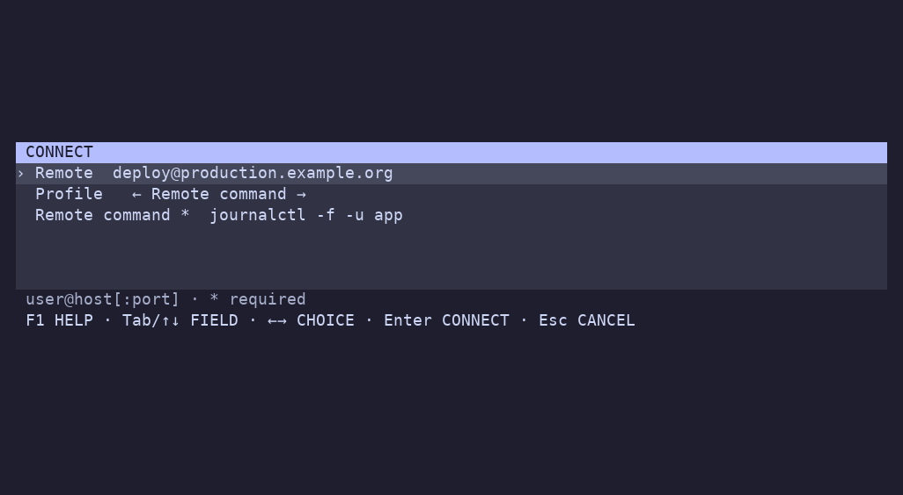

# Adjust one connection



Press **Ctrl+Enter** on a host to change its remote (`user@host:port`), profile, and configured inputs before connecting. **Tab / Shift-Tab** or **Up / Down** moves between fields; **Left / Right** switches the profile or a pick-list value. Type to edit text; **Ctrl-Backspace / Ctrl-Delete** erases a word. **Enter** connects; **Esc** cancels.

Your terminal must send a distinct Ctrl+Enter sequence (such as CSI `13;5u`). Terminals that send ordinary Enter for both keys cannot distinguish them.

Profiles can declare `inputs` just like configuration scripts. Use `%{input:id}` in a command or named field; values are shell-escaped. Profiles with inputs also open this dialog on Enter or their shortcut, so required values cannot be bypassed. Input generators run when the profile is selected in the dialog. Values are cached only while that dialog is open.

```yaml
default: SSH
profiles:
  - name: SSH
    command: ssh %h
  - name: Remote command
    command: ssh %h %{input:remote}
    inputs:
      - id: remote
        type: promptString
        description: Remote command
        default: uptime
        required: true
```

Both `promptString` and `pickString`, optional generator `command`, defaults, and required fields use the same format as setup inputs. Inputs are visible text: do not use them for passwords. Changes are temporary and do not modify your configuration or history. Ordinary connections still record history as usual.
