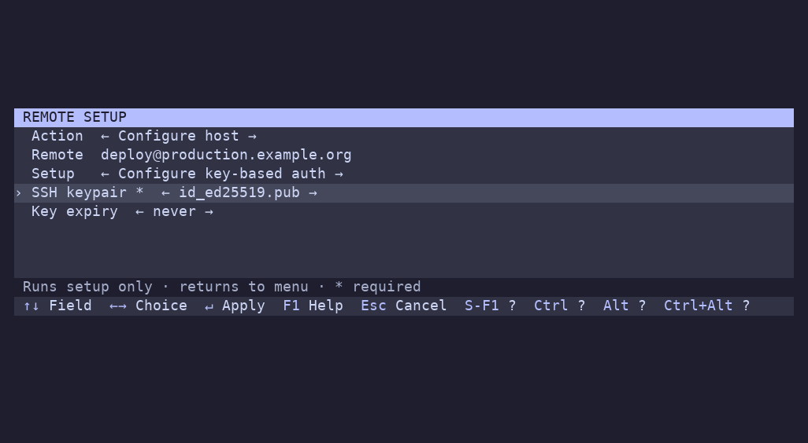

# Setting up a remote

Press **F4** to open remote setup for the selected host. Press **Shift+F4** to open **Add new** directly with an empty address. With no selected host, F4 also starts in **Add new** mode.

Use Left/Right on **Action** to switch between:

- **Configure host**: the selected address is filled in. Choose a setup recipe and press **Enter** to apply it. Shui returns to the host list with a success or failure message, preserving your filter and profile choices. It does not launch a connection or save a history entry.
- **Add new**: enter `user@host[:port]` (or `user@[IPv6]:port`), and optionally choose a setup recipe. **Enter** adds and connects using the default launch profile; **Alt+Enter** returns to the menu after the connection ends.

Each action retains its own address draft while you switch. Tab/Shift-Tab or Up/Down moves between fields; Left/Right changes the action, recipe, or dropdown choice. **Esc** cancels. All controls can be rebound under `keybindings.dialog`.

The included setup recipes are:

| Recipe | What it does |
| --- | --- |
| **Configure key-based auth** | Selects an existing keypair or offers generation when none is available, then copies its public key with ssh-copy-id |
| **Configure key-based auth + install dotfiles** | Copies the key, uploads a dotfiles directory, and runs its installer |
| **Copy terminal definition** | Exports local `$TERM` and compiles it into remote `~/.terminfo` for terminals unknown to the server |

The dotfiles sample defaults to local `~/src/dotfiles`, installer `install.sh`, and shell `sh`. Change the dialog values or edit the recipe for your own repository. Both key-based auth samples remain available when no matching `~/.ssh/id_*` private/public keypairs exist. The key selector reads filenames, not key contents. If no usable pair is found, it offers **Generate new Ed25519 key** instead.

Generation runs only after confirming setup, never while opening or canceling the dialog. It uses `ssh-keygen` to create the standard `~/.ssh/id_ed25519` pair, with the terminal restored for its passphrase prompts. No empty passphrase is forced. Existing private or public files (including symlinks) are not overwritten; restore an incomplete pair or choose another existing pair before retrying. Failure stops setup before `ssh-copy-id` or the connection runs. The generated key remains on disk if later setup fails.

Both key-auth recipes offer **Key expiry**: never (default), 8 hours, day, week, month, or year. After copying the key, setup applies OpenSSH's [`expiry-time`](https://man.openbsd.org/sshd.8#expiry-time) option using the server's clock and UTC. Month means 30 days; year means 365 days. **Never** removes an existing expiry for that key. Every matching entry is updated, preserving other restrictions, comments, and unrelated keys. Expiry blocks new authentication; it does not disconnect existing sessions.

The updater expects a regular remote `~/.ssh/authorized_keys` file and an OpenSSH server supporting `expiry-time`. Custom authorized-key locations require adapting the recipe. If the post-copy update fails, setup reports failure, but the copied key remains installed.

Existing configuration files are preserved. To adopt these samples in an existing installation, copy the desired entries under `configuration_scripts` from the [updated example](../shui-config.example.yml); keep your custom recipes.

Setup defaults to **None**. Configure mode requires a recipe; adding a remote can skip setup. Authentication prompts run with the terminal restored. Failed setup prevents adding or connecting. In configure mode, failures return to the menu so you can retry. Setup is not repeated on later connections. The dialog itself does not edit SSH config; the selected recipe determines what changes on the local or remote machine.

## Terminal compatibility

Launch profiles handle their own tool dependencies. Select Monitor, Tmux, Mosh, or another profile to check and optionally install what it needs; tool installation is not a host setup recipe.

**Copy terminal definition** addresses errors such as `unknown terminal: xterm-kitty`. It uses the method documented by [Kitty](https://github.com/kovidgoyal/kitty/blob/master/docs/kittens/ssh.rst), generalized to the current `$TERM`. Local `infocmp` and remote `tic` (ncurses tools) are required. The remote compiles a temporary source file, which also works on systems whose tic cannot read `/dev/stdin`, and removes it afterward. Matching definitions in `~/.terminfo` are updated; system definitions are untouched. The recipe is hidden if local ssh, infocmp or TERM is missing. It copies terminal capabilities, not fonts or shell integration.

Each setup run selects one recipe. The terminal-definition recipe uses existing authentication; configure key-based auth first or authenticate normally when prompted.

## Custom inputs

Recipes belong under top-level `configuration_scripts` and share the profile command format. Commented examples are in the shipped config; F9 opens your copy.

`promptString` creates a text field; `pickString` creates a dropdown. IDs are unique within a recipe and contain letters, digits, `_`, or `-`. `description` supplies the label, otherwise the ID is shown. Text fields default to empty; dropdowns default to their first option. The `required` flag rejects blank values.

Pass remote-script inputs as positional arguments, as shown in the config comments. Values survive switching recipes within the dialog but are not saved to YAML or history. Fields display plain text and are intended for installation parameters. Launch profiles also support these input declarations in the connection dialog (Ctrl+Enter).

## Generate field defaults or choices

An input's `command` can produce a YAML or JSON object containing `default`, `options`, and/or `description`. Returned fields override static values; omitted fields remain unchanged.

Generators run when the recipe is first selected. Successful results are cached for that dialog. A failure blocks submission and displays an error; switch away and back to retry. Output must be a valid mapping of at most 64 KiB; dropdown choices must be nonempty and contain the default if one is specified. The shipped SSH key selector uses this mechanism.

## Show a recipe only when available

A recipe’s `available_command` controls whether it appears in the selector. The config comments include a custom availability check.

Exit **0** shows the recipe; another status or failure to start hides it. Without a check, the recipe is always available. Checks run once each time the dialog opens, and **None** is always an option. Hidden recipes' input generators do not run.

Availability checks and input generators are literal local `sh -c` commands with stdin closed. Use quick, noninteractive commands; menu placeholders are not expanded inside them. Availability output is discarded; generator stdout is parsed as configuration. Setup recipe checks and input generators do not run during config loading or ordinary connections. Launch profiles can also define `available_command`; those checks run once at startup.
