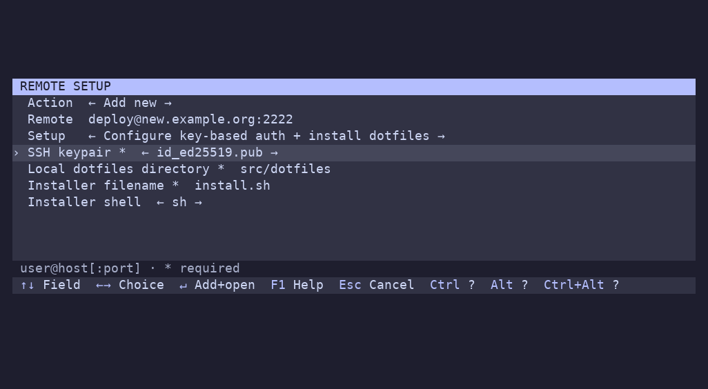

# Setting up a remote

Enter `user@host[:port]` (or `user@[IPv6]:port`), and choose an optional setup recipe. Tab/Shift-Tab or Up/Down moves between fields; Left/Right changes a recipe or dropdown choice.



The samples included in the config are:

| Recipe | What it does |
| --- | --- |
| **ssh-copy-id** | Lets you pick a local SSH keypair and copies its public key to the remote |
| **ssh-copy-id + dotfiles** | Copies the key, uploads a dotfiles directory, and runs its installer |

The dotfiles sample defaults to local `~/src/dotfiles`, installer `install.sh`, and shell `sh`. Change the dialog values or edit the recipe for your own repository. Both samples are hidden when no matching `~/.ssh/id_*` private/public keypairs exist. The key selector reads filenames, not key contents.

Setup defaults to **None**. **Enter** runs the selected setup, saves the connection to history, and connects using the default launch profile. **Esc** cancels. Authentication prompts run with the terminal restored. Failed setup stops the connection and does not save the entry. Setup is not repeated on later connections, and SSH config is not modified.

## Custom inputs

Add recipes under top-level `configuration_scripts`. They use the same command templates as launch profiles, plus optional `inputs`:

```yaml
configuration_scripts:
  - name: Install tools
    inputs:
      - id: email
        type: promptString
        description: Git email
        required: true
      - id: mode
        type: pickString
        description: Install mode
        options: [minimal, full]
        default: minimal
    command: port=%p; exec ssh ${port:+-p "$port"} -tt -- %h %{remote}
    remote: sh -c %{script} -- %{input:email} %{input:mode}
    script: |
      exec ~/bin/install-tools.sh --email "$1" --mode "$2"
```

`promptString` creates a text field; `pickString` creates a dropdown. IDs are unique within a recipe and contain letters, digits, `_`, or `-`. `description` supplies the label, otherwise the ID is shown. Text fields default to empty; dropdowns default to their first option. `required: true` rejects blank values.

Pass remote-script inputs as positional arguments, as above. Values survive switching recipes within the dialog but are not saved to YAML or history. Fields display plain text and are intended for installation parameters. Input declarations are supported only in setup recipes.

## Generate field defaults or choices

An input's `command` can produce a YAML or JSON object containing `default`, `options`, and/or `description`. Returned fields override static values; omitted fields remain unchanged. For example, place this under a recipe:

```yaml
inputs:
  - id: email
    type: promptString
    command: |
      email=$(git config --global user.email) || exit 1
      escaped=$(printf '%s' "$email" | sed "s/'/''/g")
      printf "default: '%s'\n" "$escaped"
  - id: mode
    type: pickString
    command: printf '%s' '{"options":["minimal","full"],"default":"full"}'
```

Generators run when the recipe is first selected. Successful results are cached for that dialog. A failure blocks submission and displays an error; switch away and back to retry. Output must be a valid mapping of at most 64 KiB; dropdown choices must be nonempty and contain the default if one is specified. The shipped SSH key selector uses this mechanism.

## Show a recipe only when available

A recipe's `available_command` controls whether it appears in the selector. For example:

```yaml
configuration_scripts:
  - name: Copy SSH key
    available_command: |
      for public in "$HOME"/.ssh/id_*.pub; do
        [ -f "$public" ] && [ -f "${public%.pub}" ] && exit 0
      done
      exit 1
    command: port=%p; exec ssh-copy-id ${port:+-p "$port"} %h
```

Exit **0** shows the recipe; another status or failure to start hides it. Without a check, the recipe is always available. Checks run once each time the dialog opens, and **None** is always an option. Hidden recipes' input generators do not run.

Availability checks and input generators are literal local `sh -c` commands with stdin closed. Use quick, noninteractive commands; menu placeholders are not expanded inside them. Availability output is discarded; generator stdout is parsed as configuration. Setup recipe checks and input generators do not run during config loading or ordinary connections. Launch profiles can also define `available_command`; those checks run once at startup.
