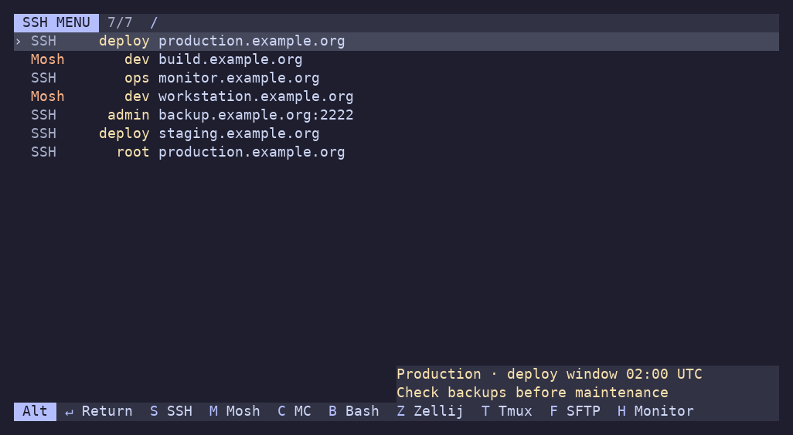

# Using SSH Menu

Your existing hosts appear automatically in three aligned, borderless columns: launch profile (left), username (right, highlighted), and host (left). The selection marker sits beside the row. An unspecified username leaves its column blank; explicit ports stay with the host.

1. Type a hostname fragment, SSH config detail, comment, or fuzzy abbreviation and select a matching row with **↑ / ↓**.
2. Use **← / →** to choose how that host opens, then press **Enter**.

Changing a profile affects only the selected host. Moving away or changing the filter preserves the choice while the menu is open.

| Key | Action |
| --- | --- |
| Type | Fuzzy search username, host, port and config hint text; space-separated terms all must match |
| ↑ / ↓ · PgUp / PgDn | Move through hosts |
| ← / → | Change the selected host's profile |
| Enter | Connect |
| Alt+Enter | Connect and return to the menu afterward |
| Ctrl+Enter | Adjust the remote, profile and inputs for one connection |
| Alt+S / Alt+M / Alt+C | Connect with SSH / Mosh / MC |
| Alt+B / Alt+Z / Alt+T | Connect with remote Bash / Zellij / Tmux |
| Alt+F / Alt+H | Open SFTP / remote monitor |
| Ctrl+Alt+L / Ctrl+Alt+D | Configure a local tunnel / SOCKS proxy |
| F1 | Open built-in help |
| F2 | Add a remote with optional setup |
| F4 | Edit configuration with format help and validation |
| F8 | Toggle plain SSH / Mosh for the selected host |
| Backspace / Delete | Remove the last character |
| Ctrl-Backspace / Ctrl-Delete | Remove the last word |
| Esc / Ctrl-C | Quit |

All keys listed here are defaults and can be changed in `keybindings`; see the Keys help topic for active bindings. Hold Alt to reveal the shipped profile shortcuts in the bottom bar, or see Keys in help. A shortcut connects immediately using the selected host. Ctrl+Q has no built-in action and may be assigned to a profile.

Editing happens at the end of the text. Ctrl-Backspace also accepts the legacy Ctrl-H encoding.

## Where hosts and remembered profiles come from

SSH Menu reads `~/.ssh/config`, `~/.bash_history`, and `~/.config/mc/hotlist`. Duplicate targets are merged; recently encountered connections appear first. The SSH config reader handles explicit `Host` and `User` sections and skips wildcard aliases. It does not expand `Include` or `Match`; SSH itself resolves connection settings at launch.

On startup, history entries are matched against configured profiles. Host, username, and explicit port distinguish entries. Unknown or ambiguous commands fall back to the default profile. History is parsed as data, never executed.

Launching appends its command to an existing `.bash_history`; adding a remote creates that file if needed. Switching profiles and quitting writes nothing. Generated commands include a target comment so custom commands can be rediscovered. Run `history -a` in another Bash session to make its recent commands visible.

## How the Zellij profile works

The recipe attaches to an existing remote session, or creates one if none exists. It reuses an installed Zellij; otherwise it installs pinned **0.45.1** into remote `~/.local/bin` and verifies the executable's SHA-256 against the published checksum. It uses no sudo and leaves existing installations in place.

Automatic installation supports Linux x86-64 and ARM64 and requires `tar`, `curl` or `wget`, and `sha256sum` or `shasum`. See the [bootstrap script](https://github.com/azazar/ssh-menu/blob/master/scripts/zellij-remote.sh) for the complete recipe.

## Built-in help

Press **F1** from the host list or new-remote dialog to read these docs without leaving SSH Menu. The host list shows Guide, Profiles and Bindings; dialogs show relevant connection/setup documentation. Every screen includes a Keys topic with its active shortcuts.

- **Left/Right or Tab/Shift-Tab:** switch topics.
- **Up/Down:** scroll one line.
- **PgUp/PgDn or Space:** scroll a page.
- **Home/End:** jump to the start or end.
- **Esc, F1, or q:** close help and return to where you were.

The app version appears in the top-right corner of help. The help viewer wraps text to the terminal width and shows your position in each topic. Resizing adjusts the layout. It preserves your host filter, selected profile, and unfinished dialog inputs. Links are displayed as text; use the topic keys to navigate. The documentation is embedded in the binary, so help works offline without installed documentation files.

## Search config details and comments

Search includes the complete text used by each host's configuration hint, even when the popup is hidden or clipped. For example, search an underlying `HostName` address, identity filename, port, or a note such as `maintenance`. Space-separated terms may match different fields (`deploy maintenance`); every term must match. Matching is case-insensitive and supports fuzzy abbreviations in both names and hints. Hostname/username/port matches rank ahead of matches that need hint text; within each group, substring matches rank ahead of fuzzy matches, with recency breaking ties. A fuzzy term matches within a single hint line, not across unrelated lines.

## Host configuration hint

When a selected SSH config entry has an explicit `User`, its complete source block appears in a borderless hint at the bottom right: the `Host` line, settings, and comments. A comment group immediately before `Host` belongs to that entry, even when indented; comments inside the block and inline comments remain in place. Multiple matching blocks are shown in file order. Hints match the configured username and alias, including entries rediscovered from history; they are not copied to synthetic root entries. This is the source configuration, not SSH’s resolved settings: wildcards, `Include`, and `Match` expansion are not supported. The popup grows with the block up to the available screen height; very long blocks can still be clipped, and small terminals hide the hint to leave room for hosts.

## After disconnecting

Use **Alt+Enter** (`connect_and_return`) to reopen the menu after the launched command exits, including nonzero exit status. Your filter, row and per-host profile choices remain. **Enter** (`connect`) hands the terminal directly to the connection. Both actions are available in dialogs as well as the host list and can be rebound independently.

## Adjusting and editing

**Ctrl+Enter** opens a connection dialog; profiles with inputs also open it on Enter or their shortcut. Changes are temporary and are not written to history. The terminal must support distinct modified Enter events. Press F1 in the dialog for input examples.

**F4** immediately launches `$VISUAL`, then `$EDITOR`, or `vi` as fallback, skipping empty values. Editor arguments are supported. If the editor fails or validation rejects the file, a recovery screen offers Edit to retry, F1 for the format reference, and Esc to keep the active configuration. After a successful editor exit, YAML, templates, inputs and shortcut conflicts are validated and profile availability is refreshed. Valid changes take effect immediately; invalid changes remain on disk for correction while the current configuration stays active. Configuration files are created only when `~/.ssh` already exists.

## One-row action bar

The menu, dialogs, help and configuration editor use the same single-row bar. Keys are highlighted against a quiet shared background. The profile selector shows both neighbors, for example `Bash ← → SSH`; the current profile remains in the selected host row. Directional hints show both directions (`←→`, `↑↓`). On narrow terminals, lower-priority hints are omitted; Keys in help lists all bindings, including profile shortcuts.

Hold **Alt** to reveal Alt shortcuts, **Ctrl+Alt** for that exact group, or **Ctrl** for Ctrl shortcuts. Releasing the modifiers restores the normal bar. Idle prompts show `Alt ?`, `Ctrl+Alt ?` and `Ctrl ?`. Holding modifiers requires a terminal supporting Kitty keyboard modifier press/release events. In other terminals, **Alt+?**, **Ctrl+Alt+?** or **Ctrl+?** toggles the corresponding hints; the next ordinary key also closes the reveal. These toggles only reveal bindings: still press the full shortcut to invoke an action. They are configurable as `reveal_alt`, `reveal_ctrl_alt` and `reveal_ctrl` in each screen's binding map.

Within a revealed group the modifier prefix is shown once; `S SSH` under Alt means Alt+S. Elsewhere compact key labels use `C-` for Ctrl, `A-` for Alt, `S-` for Shift and `↵` for Enter. Terminal keyboard and focus-reporting modes are restored before launching a connection or external editor.
