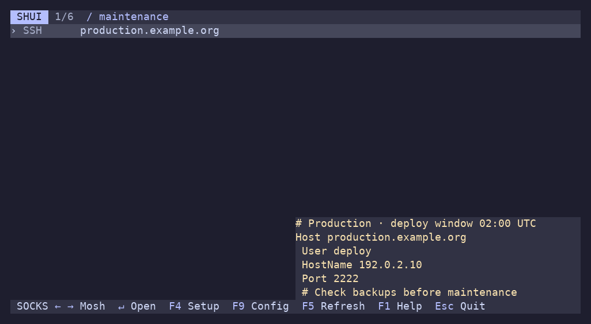
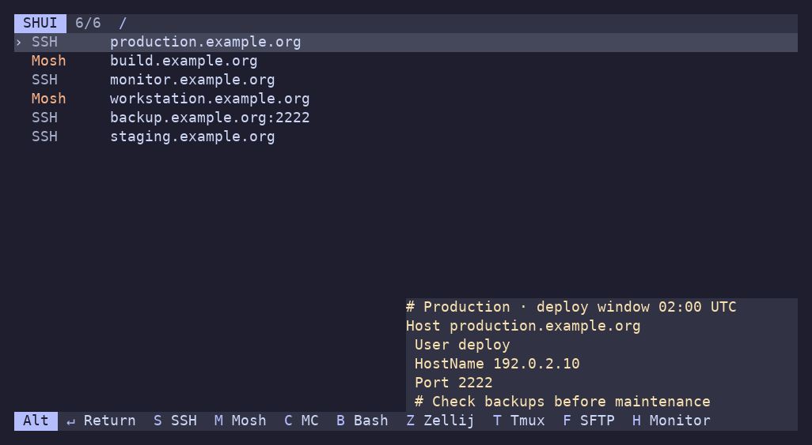
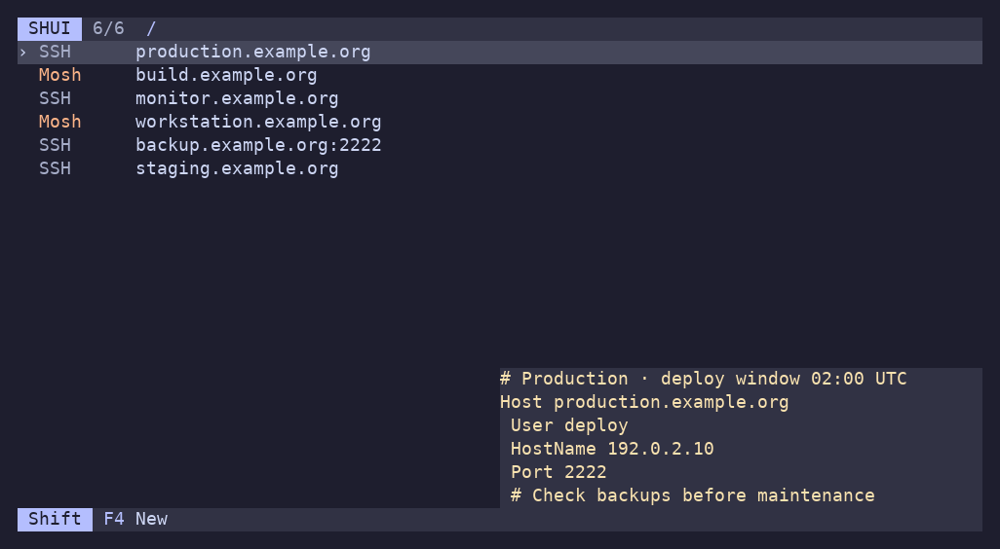

# Using Shui

Your existing hosts appear automatically in three aligned, borderless columns: launch profile (left), username (right, highlighted), and host (left). The selection marker sits beside the row. An unspecified username leaves its column blank; explicit ports stay with the host.

1. Type a hostname fragment, SSH config detail, comment, or fuzzy abbreviation and select a matching row with **↑ / ↓**.
2. Use **← / →** to choose how that host opens, then press **Enter**.

You can start with a filter directly: `shui production` or `shui "deploy database"`. With no saved hosts, the menu shows how to add one; an empty search result suggests clearing the filter or adding a remote.

On Linux, if stdin or stdout is not a terminal and `DISPLAY` or `WAYLAND_DISPLAY` is nonempty, Shui opens a desktop terminal. It uses the first available launcher from `xdg-terminal-exec`, `sensible-terminal`, and `x-terminal-emulator`, preserving your arguments and working directory. Use `shui --no-terminal [QUERY]` to require an existing terminal instead. Read-only commands such as `--dump` never open a window. Headless Linux, macOS and Windows still require a terminal for interactive mode.

Changing a profile affects only the selected host. Moving away or changing the filter preserves the choice while the menu is open.

| Key | Action |
| --- | --- |
| Type | Fuzzy search username, host, port and config hint text; space-separated terms all must match |
| ↑ / ↓ · PgUp / PgDn | Move through hosts |
| ← / → | Change the selected host's profile |
| Enter | Connect |
| Alt+Enter | Connect and return to the menu afterward |
| Ctrl+Enter | Adjust the remote, profile and inputs for one connection |
| Alt+D / Alt+P / Alt+L | Connect with Dropbear / Windows PuTTY / Windows Plink (when installed) |
| Alt+S / Alt+M / Alt+C | Connect with SSH / Mosh / MC |
| Alt+B / Alt+Z / Alt+T | Connect with remote Bash / Zellij / Tmux |
| Alt+F / Alt+H | Open SFTP / remote monitor |
| Ctrl+Alt+L / Ctrl+Alt+D | Configure a local tunnel / SOCKS proxy |
| F1 | Open built-in help |
| F4 | Configure the selected host |
| Shift+F4 | Add a new remote |
| F9 | Edit configuration with format help and validation |
| F8 | Toggle plain SSH / Mosh for the selected host |
| F5 | Refresh hosts and SSH config hints, preserving the filter and profile choices |
| Home / End | Select the first / last matching host |
| Ctrl-U | Clear the search |
| Backspace / Delete | Remove the last character |
| Ctrl-Backspace / Ctrl-Delete | Remove the last word |
| Esc / Ctrl-C | Quit |

All keys listed here are defaults and can be changed in `keybindings`; see the Keys help topic for active bindings. Hold Alt to reveal the shipped profile shortcuts in the bottom bar, or see Keys in help. A shortcut connects immediately using the selected host. Ctrl+Q has no built-in action and may be assigned to a profile.

Editing happens at the end of the text. Ctrl-Backspace also accepts the legacy Ctrl-H encoding.

If a search has no matches and is a valid address, **Enter** connects directly; the empty-result message shows the target and profile before you launch. Profile arrows, F8 and profile shortcuts also work for that address. **Alt+Enter** returns afterward and keeps the new host in the list. Multiword searches are never treated as addresses.

## Where hosts and remembered profiles come from

Shui reads `~/.ssh/config`, `~/.bash_history`, and `~/.config/mc/hotlist`. Duplicate targets are merged; recently encountered connections appear first. SSH config entries appear as their actual aliases. Shui leaves the username and other connection settings to OpenSSH; it does not invent root connections. Explicit usernames and ports from history or bookmarks remain separate targets. The host list hides usernames unless multiple accounts need distinguishing; `username_display: always` or `never` overrides this. Commands omit a username matching a proven static SSH `User` setting. Different or uncertain accounts stay explicit.

The SSH config reader accepts quoted values, `Keyword=value` syntax and multiple aliases. It expands `Include` files, including wildcard paths in lexical order, absolute paths and `~/` paths. Relative includes resolve from `~/.ssh`, including nested files. Wildcard and negated `Host` patterns supply context but do not create targets. Included files respect their surrounding `Host` or `Match` scope. Shui does not execute `Match exec` or other SSH directives during discovery.

Discovery is a bounded, best-effort index: unreadable files, cycles, non-file paths and includes beyond 16 levels, 256 files or 4 MiB total are skipped. The index also caps aliases at 4096 and limits stored hint text. Dynamic Include paths containing SSH tokens or environment variables, other users' `~name` paths, and full `Match` evaluation are left to OpenSSH. The original alias is always passed to the selected connection tool, so OpenSSH resolves the actual settings at launch.

On startup, history entries are matched against configured profiles. Host, username, and explicit port distinguish entries. Unknown or ambiguous commands fall back to the default profile. History is parsed as data, never executed.

Launching appends its command to an existing `.bash_history`; adding a remote creates that file if needed. History write failures are reported without preventing the connection, and a missing final newline is repaired before appending. Switching profiles and quitting writes nothing. Generated commands include a target comment so custom commands can be rediscovered. Run `history -a` in another Bash session, then press **F5** to refresh hosts without restarting Shui. History reads use the most recent 8 MiB and skip a partial leading line. Imports recover targets and matching profiles, not arbitrary command-line overrides such as `-F`, `-i` or `-J`; put reusable connection settings in SSH config.

## How the Zellij profile works

The recipe attaches to an existing remote session, or creates one if none exists. It reuses an installed Zellij; otherwise it offers to install pinned **0.45.1** into remote `~/.local/bin` and verifies the executable's SHA-256 against the published checksum. It uses no sudo and leaves existing installations in place.

Automatic installation supports Linux x86-64 and ARM64 and requires `tar`, `curl` or `wget`, and `sha256sum` or `shasum`. See the [Zellij recipe in the config](config.example.yml) for the complete recipe.

## Built-in help

Press **F1** from the host list or remote setup dialog to read these docs without leaving Shui. The host list shows Guide, Profiles and Bindings; dialogs show relevant connection/setup documentation. Every screen includes a Keys topic with its active shortcuts.

- **Left/Right or Tab/Shift-Tab:** switch topics.
- **Up/Down:** scroll one line.
- **PgUp/PgDn or Space:** scroll a page.
- **Home/End:** jump to the start or end.
- **Esc, F1, or q:** close help and return to where you were.

The app version appears in the top-right corner of help. The help viewer wraps text to the terminal width and shows your position in each topic. Resizing adjusts the layout. It preserves your host filter, selected profile, and unfinished dialog inputs. Links are displayed as text; use the topic keys to navigate. The documentation is embedded in the binary, so help works offline without installed documentation files.

## Search config details and comments

Search includes the complete text used by each host's configuration hint, even when the popup is hidden or clipped. For example, search an underlying `HostName` address, identity filename, port, or a note such as `maintenance`. Space-separated terms may match different fields (`deploy maintenance`); every term must match. Matching is case-insensitive and supports fuzzy abbreviations in both names and hints. Hostname/username/port matches rank ahead of matches that need hint text; within each group, substring matches rank ahead of fuzzy matches, with recency breaking ties. A fuzzy term matches within a single hint line, not across unrelated lines.

## Host configuration hint

The selected SSH config alias shows its source configuration in a borderless hint at the bottom right, including aliases without an explicit `User`: the `Host` line, settings, and comments. A comment group immediately before `Host` belongs to that entry, even when indented; comments inside the block and inline comments remain in place. Matching static blocks and included settings are shown in source order. Hints also match explicit-user history entries when the first applicable `User` can be determined without evaluating a dynamic `Match`. This is source configuration, not a report of SSH’s resolved settings; dynamic `Match` blocks are omitted. Hints use spare space beside or below host text and disappear when they would cover it. Very long blocks can be clipped, and small terminals hide the hint to leave room for hosts.

## After disconnecting

Use **Alt+Enter** (`connect_and_return`) to reopen the menu after the launched command exits, including nonzero exit status. Your filter, row and per-host profile choices remain, newly added targets remain available, and unsuccessful connections show their exit status. Results replace the footer until the next key, keeping the host list in place. **Enter** (`connect`) hands the terminal directly to the connection. Both actions are available in dialogs as well as the host list and can be rebound independently.

## Adjusting and editing

**Ctrl+Enter** opens a connection dialog; profiles with inputs also open it on Enter or their shortcut. Changes are temporary and are not written to history. The terminal must support distinct modified Enter events. Press F1 in the dialog for input help; configuration examples are in the config comments.

**F9** immediately launches `$VISUAL`, then `$EDITOR`, then the first installed Unix helper among `sensible-editor`, `editor`, and `vi` (Notepad on Windows), skipping empty values. This respects the editor selected through `sensible-editor`, such as mcedit. An explicit editor override or an editor that starts and fails is not replaced by a fallback. Editor arguments are supported. If the editor fails or validation rejects the file, a recovery screen offers Edit to retry, F1 for the format reference, and Esc to keep the active configuration. After a successful editor exit, YAML, templates, inputs and shortcut conflicts are validated and profile availability is refreshed. Valid changes take effect immediately; invalid changes remain on disk for correction while the current configuration stays active. Configuration is stored in `$XDG_CONFIG_HOME/shui.yml`, defaulting to `~/.config/shui.yml`; missing directories are created automatically.

## One-row action bar

The menu, dialogs, help and configuration editor use the same single-row bar. Keys are highlighted against a quiet shared background. The profile selector shows both neighbors, for example `Bash ← → SSH`; the current profile remains in the selected host row. Directional hints show both directions (`←→`, `↑↓`). On narrow terminals, lower-priority hints are omitted; Keys in help lists all bindings, including profile shortcuts.

Hold **Alt**, **Shift**, **Ctrl**, or a combination to reveal only that exact group's shortcuts. Shift shows **F4 New**; Alt shows profile shortcuts; Ctrl+Alt shows its own shortcuts without Alt-only or Ctrl-only entries. Releasing keys updates the group; releasing all restores the unmodified bar.

Holding modifiers requires Kitty keyboard modifier press/release events. In other terminals, **Alt+?**, **Ctrl+?**, **Ctrl+Alt+?**, and **Shift+F1** toggle the corresponding menu; the next ordinary key closes it. These only reveal bindings: press the full shortcut to invoke an action. The configurable actions are `reveal_alt`, `reveal_ctrl`, `reveal_ctrl_alt`, and `reveal_shift` in each screen's binding map.

Within a revealed group the modifier prefix is shown once; `S SSH` under Alt means Alt+S. Elsewhere compact key labels use `C-` for Ctrl, `A-` for Alt, `S-` for Shift and `↵` for Enter. Terminal keyboard and focus-reporting modes are restored before launching a connection or external editor.

## Requirements

Use a UTF-8 terminal with a monospace font. The action bar needs no Powerline or Nerd Font glyphs. Install the tools for the profiles you use: `ssh` for normal connections, `mosh` locally and `mosh-server` remotely for Mosh, or local `mc` for file browsing. SFTP uses local `sftp`; Tmux needs remote `tmux`; Monitor needs remote `btop` (GPU support depends on its build and the remote drivers). The terminal-definition recipe needs local `infocmp` and remote `tic`. Key-auth setup uses `ssh-copy-id` and offers `ssh-keygen` when no keypair exists; the dotfiles sample also uses `scp`.

## Command-line options

Run `shui` to open the menu, or `shui prod` to start with a search filter. Use `shui --dump` to list hosts without opening the UI. `shui --default-config` prints this build’s complete defaults without changing files. `shui --config-path` prints the configuration location, and `shui --check-config` validates the current configuration without running commands. Use `shui --check-config ./config.yml` for a draft file. `--help` and `--version` are also available.
